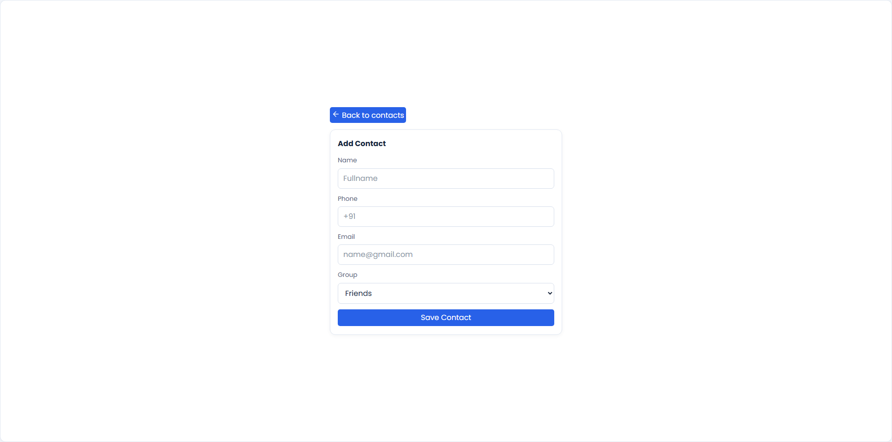
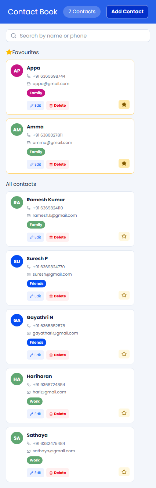

# Contact App

A responsive React contact manager for adding, searching, viewing, editing, deleting, and favouriting contacts.

## 🔗 Live Link

https://contact-app-1-1oo8.onrender.com


> Run the frontend and JSON server using the steps below. Add a deployed URL here once the app is hosted.

## Screenshots

### Desktop View




### Mobile view



## Features

- Add, edit, view, and delete contacts
- Mark contacts as favourites
- Search contacts by name or phone number
- Group contacts into Friends, Family, or Work
- Validate names, 10-digit phone numbers, emails, duplicates, and required fields
- View loading and error states
- Show toast notifications after successful actions
- Responsive desktop and mobile layouts

## Tech Stack

- React - UI library
- TypeScript - Type-safe application development
- Redux Toolkit - Contact state and async request management
- React Router- Page and contact-detail routing
- Tailwind CSS- Responsive styling
- Vite - Frontend build tool
- JSON Server - Local REST API using `db.json`

## API

The frontend uses a REST API served by JSON Server:

- Base URL: `https://contact-app-yh8z.onrender.com/contacts`
- Data file: `db.json`
- Supported operations: list, create, update, toggle favourite, and delete

Create a `.env` file in the `Frontend` directory:

```env
VITE_API_URL=https://contact-app-yh8z.onrender.com/contacts
```

## Run Locally
From the repository root:

```sh
cd Frontend
npm install
```

Start JSON Server in one terminal:

```sh
npm run server
```

Start the Vite frontend in a second terminal:

```sh
npm run dev
```

Open [http://localhost:5173](http://localhost:5173) in your browser.

To create a production build:

```sh
npm run build
```

## What I Learned

### Phase 1: Project Setup

Learned how to set up a Vite React and TypeScript project, organize reusable components, and use environment variables for the API URL.

### Phase 2: UI and Responsive Design

Learned how to build responsive layouts with Tailwind CSS and create consistent cards, forms, navigation, loading states, and mobile-friendly pages.

### Phase 3: State Management

Learned how Redux Toolkit slices, selectors, async thunks, and typed hooks can manage contact data and API operation states in one predictable store.

### Phase 4: Routing and CRUD

Learned how React Router handles list, add, detail, edit, and not-found pages, and how to connect those views to create, read, update, and delete operations.

### Phase 5: Validation and User Experience

Learned how to validate form input, prevent duplicate phone numbers, debounce search, handle API errors, and provide users with clear toast feedback.
